# Exploratory Data Analysis (EDA) Report

What the MRI data looks like before any model sees it: how many patients and scans we have, what the four MRI types
show, how big the tumors are and what they are made of, how unbalanced the classes are, where tumors sit, how the
intensities differ between scans, whether training and validation look alike, and which cases are hard.

> Research prototype on public data. Everything here describes the datasets; nothing is a clinical finding.

**Produced by** `notebooks/06_eda.ipynb` → `scripts/eda.py` (code in `src/bmts/eda/`). Every number below comes from
`results/eda/summary.json`; the per-scan tables are in `results/eda/`. Run on 12 Oct 2026.

**What was opened:** only the **training and validation** scans of BraTS 2021, MU-Glioma-Post and RHUH-GBM, after
cleaning (M1-T04: RAS orientation, 240 × 240 × 155 voxels of 1 mm, each MRI type z-scored inside the brain).
The locked test patients and the external cohorts (BraTS-Africa, UTSW-Glioma) appear in the counts only; their scans
were never read.

---

## 1. Cohorts

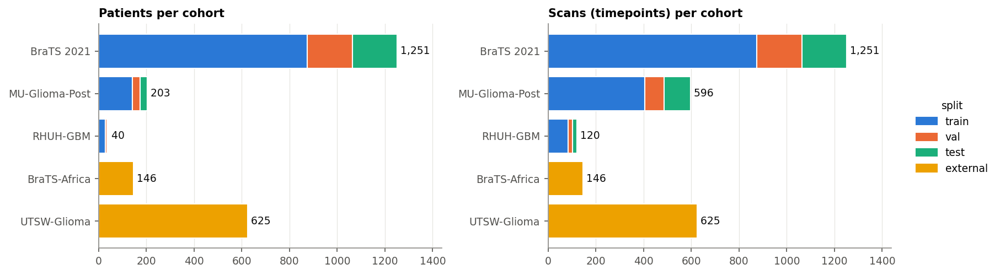

| Cohort | Role | Patients (train / val / test / external) | Scans (train / val / test / external) |
| --- | --- | --- | --- |
| BraTS 2021 | trains the models | 875 / 188 / 188 / – | 875 / 188 / 188 / – (one scan per patient) |
| MU-Glioma-Post | change over time (M3) | 142 / 31 / 30 / – | 405 / 81 / 110 / – |
| RHUH-GBM | change over time (M3) | 28 / 6 / 6 / – | 84 / 18 / 18 / – |
| BraTS-Africa | external test | – / – / – / 146 | 146 external |
| UTSW-Glioma | external test | – / – / – / 625 | 625 external |

- **No MRI type is missing:** every scan of every cohort has T1, T1ce, T2 and FLAIR.
- **Expert masks:** present for every scan except 2 MU scans (594 of 596), which the loader skips.
- **Patients are never split across groups:** all scans of one patient are in the same split (M1-T04).

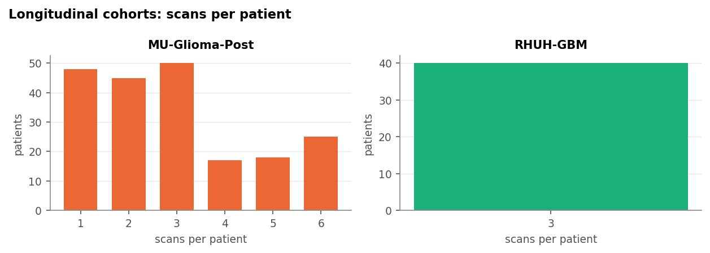

MU and RHUH follow patients over time. Every RHUH patient has 3 scans. MU patients have 1 to 6 scans, labelled
`Timepoint_1` … `Timepoint_6` (see the chart for the numbers).

## 2. What the scans look like

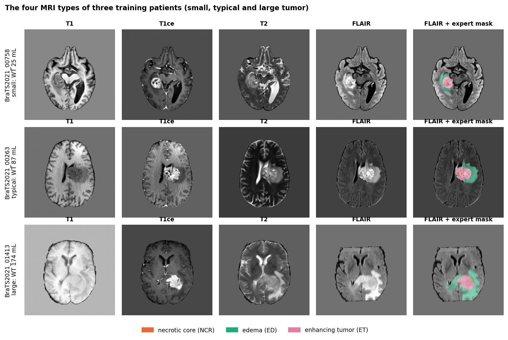

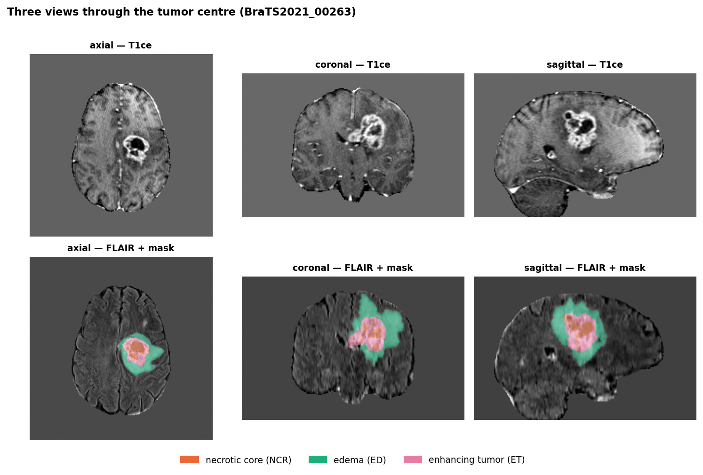

The expert masks have three tumor labels (BraTS convention): **necrotic core (NCR)**, **edema (ED)** and
**enhancing tumor (ET)**. MU masks have a fourth, **resection cavity (RC)**, because its scans are taken after
surgery. The model predicts three overlapping regions built from them:
- whole tumor (WT) = NCR + ED + ET;
- tumor core (TC) = NCR + ET;
- enhancing tumor (ET).

**Each MRI type shows a different part of the tumor.** Mean cleaned intensity per tissue (z-score, 0 = average
brain), BraTS 2021, 150 random scans:

| MRI type | healthy brain | edema | necrotic core | enhancing tumor |
| --- | --- | --- | --- | --- |
| T1 | 0.01 | 0.04 | −0.57 | −0.18 |
| T1ce | −0.01 | −0.19 | −0.37 | **2.06** |
| T2 | −0.08 | 0.78 | **1.78** | 0.98 |
| FLAIR | −0.14 | **1.96** | **2.35** | **2.44** |

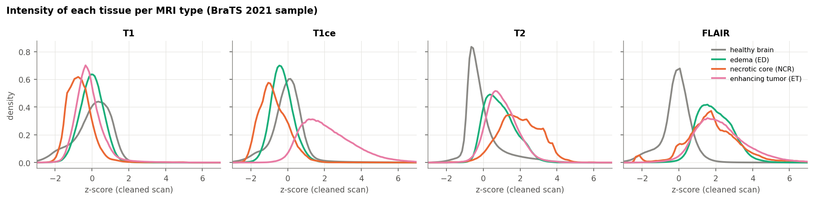

- **ET stands out only in T1ce**, about 2 standard deviations above the brain.
- **FLAIR separates the whole tumor from healthy brain**, but its three tumor parts look alike.
- **T2 makes the necrotic core brightest.**
- **MU and RHUH show the same pattern.** ET is brightest in T1ce (mean z 1.84 and 2.24).
- **The four types complement each other**, which is why the model takes all four as input: no single one shows
  all three regions.

## 3. Image geometry and intensities

**Geometry:**
- After cleaning, every opened scan is 240 × 240 × 155 voxels of 1 × 1 × 1 mm: 1,063 BraTS 2021 scans,
  484 MU-Glioma-Post scans and 102 RHUH-GBM scans.
- The raw scans did not all share one geometry. RHUH-0028 was 230 × 230 × 138 and some orientations differed
  (Milestone 1 report §6.2), so the cleaning step had to bring them to one format.

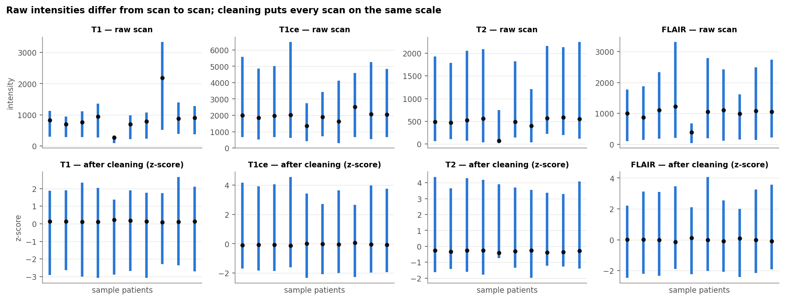

**Raw brightness varies a lot from scan to scan.** Across 10 BraTS 2021 training patients, the 99th-percentile
brain intensity of the raw scans ranges:

| MRI type | Lowest | Highest |
| --- | --- | --- |
| T1 | 338 | 3,334 |
| T1ce | 2,739 | 6,483 |
| T2 | 748 | 2,246 |
| FLAIR | 682 | 3,309 |

MRI brightness has no fixed unit, so the same tissue can have very different values in two scans. After the z-score
cleaning, every scan sits on the same scale (lower row of the figure), so the model never sees these differences.

## 4. Tumor size and composition

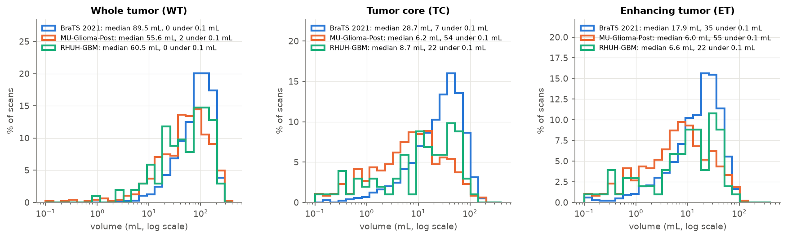

Volumes in mL (1 mL = 1,000 voxels), median and middle half (25th–75th percentile) of the scans:

| Cohort (scans) | Whole tumor | Tumor core | Enhancing | Edema | Necrotic core | Resection cavity |
| --- | --- | --- | --- | --- | --- | --- |
| BraTS 2021 (1,063) | 89.5 (50.2–138.0) | 28.7 (12.3–52.5) | 17.9 (7.4–31.7) | 52.6 (26.1–85.9) | 7.5 (2.0–19.6) | – |
| MU-Glioma-Post (484) | 55.6 (23.8–102.6) | 6.2 (1.2–16.2) | 6.0 (1.2–13.9) | 44.9 (19.9–85.9) | 0.02 (0–1.4) | 3.2 (0.5–11.6) |
| RHUH-GBM (102) | 60.5 (24.5–117.6) | 8.7 (0.3–31.5) | 6.6 (0.3–19.9) | 48.0 (22.5–78.1) | 0.4 (0–7.4) | – |

**Size range:**
- BraTS 2021 whole tumors range from 2.8 mL to 361.8 mL, so the model has to handle sizes over two orders of
  magnitude (hence the log scale).
- Every BraTS 2021 and RHUH scan has a tumor in its mask. 2 MU scans have none.
- MU scans are taken after surgery: 425 of the 484 have a resection cavity in the mask.

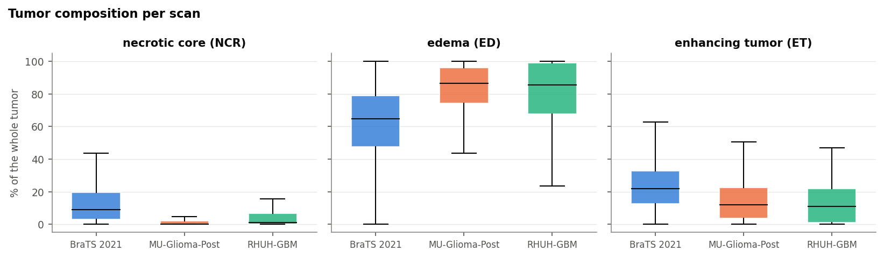

**Composition:**
- In BraTS 2021, edema makes up most of the whole tumor: median 64.7% (47.5–79.0), against 21.7% enhancing and
  8.8% necrotic.
- In MU and RHUH, edema is an even larger share of the tumor: median 86.5% and 85.5%. The necrotic core almost
  disappears: median 0.03% and 1.1%. Enhancing tumor is 11.9% and 11.0%.
- Their tumor cores are smaller than in BraTS 2021: median 6.2 and 8.7 mL against 28.7 mL. This fits scans taken
  after treatment, and it is one reason they are kept for the change-over-time module rather than for training.

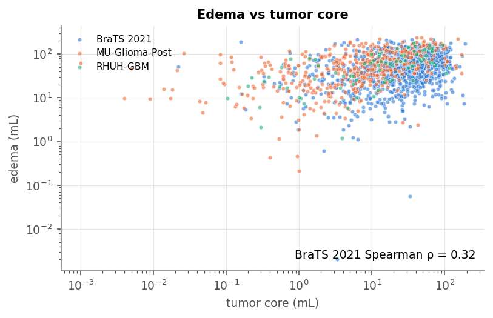

**Edema vs core:** the edema volume follows the core volume only loosely (BraTS 2021 Spearman ρ = 0.32). A large core
does not imply a large edema, so the regions have to be found separately.

## 5. Class imbalance

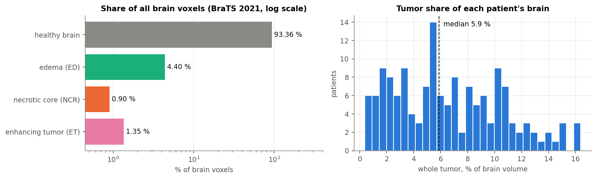

Share of all brain voxels, BraTS 2021 sample of 150 scans:

| Tissue | Share of brain voxels |
| --- | --- |
| healthy brain | 93.36% |
| edema | 4.40% |
| enhancing tumor | 1.35% |
| necrotic core | 0.90% |

- **Whole tumor per patient:** median 5.9% of the patient's brain (3.1–9.6%, at most 16.4%).
- **MU and RHUH are just as unbalanced:** ET is 0.95% and 0.90% of brain voxels, necrotic core 0.26% and 0.39%
  (samples of 150 and 102 scans).
- **Including the background around the head,** the tumor regions are an even smaller share of the 8.9 million voxels
  in a scan.

## 6. Where the tumors are

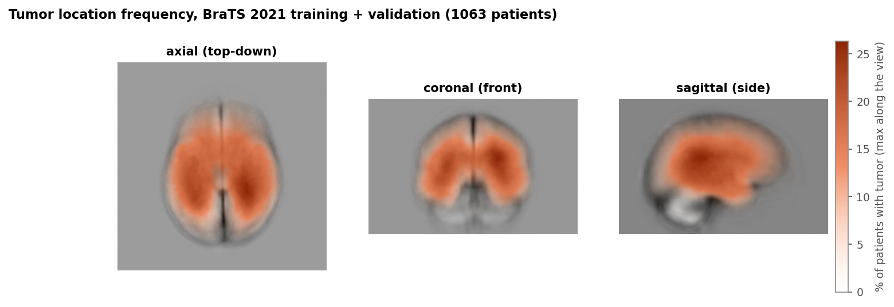

Share of the 1,063 BraTS 2021 training and validation patients with tumor at each point of the brain (highest value
along each viewing direction).
- **Tumors appear all over both cerebral hemispheres.** The tumor voxels split about evenly between the left and right
  halves of the image (49% / 51%).
- **No single point is shared by many patients.** The most frequent points are in the central part of the
  hemispheres, next to the lateral ventricles, and are covered by tumor in at most 26.3% of the patients.
- **The lowest third of the scan is rarely involved.** It holds 7.7% of all tumor voxels; this is the level of the
  cerebellum and brainstem.
- **The model must look everywhere:** it cannot rely on one typical tumor position.

## 7. Separate tumor parts and missing enhancing tumor

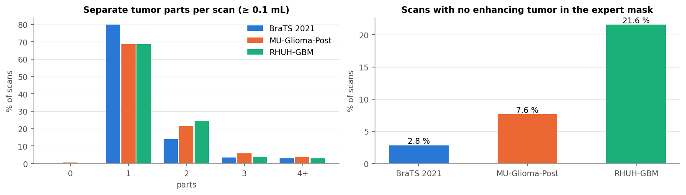

| Cohort | Scans with ≥ 2 separate tumor parts (≥ 0.1 mL each) | Scans with no ET in the expert mask | Scans with no tumor at all |
| --- | --- | --- | --- |
| BraTS 2021 | 214 (20.1%) | 30 (2.8%) | 0 |
| MU-Glioma-Post | 150 (31.0%) | 37 (7.6%) | 2 |
| RHUH-GBM | 32 (31.4%) | 22 (21.6%) | 0 |

**Why these two counts matter:**
- **Separate parts:** a model that only finds the largest blob would miss the rest of a multi-part tumor.
- **No enhancing tumor:** for these scans, any ET the model predicts is a false positive, so their ET Dice is 0 or 1
  with nothing in between. This is exactly what lowered the selected model's ET score on 3 validation patients
  (model card, `models/registry/seg-model/v1/model_card.md`).

## 8. Training vs validation

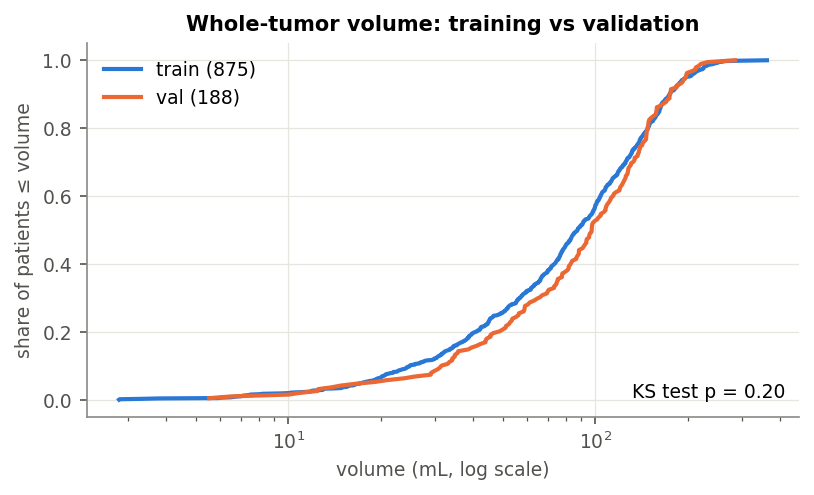

**The validation patients look like the training patients.** The Kolmogorov–Smirnov test (does a volume follow the
same distribution in both groups?) finds no significant difference at the 5% level:
- whole tumor p = 0.20;
- tumor core p = 0.07;
- enhancing tumor p = 0.22.

So the validation scores of M2 are measured on data like the training data.

## 9. Difficult cases, and how size relates to the model's score

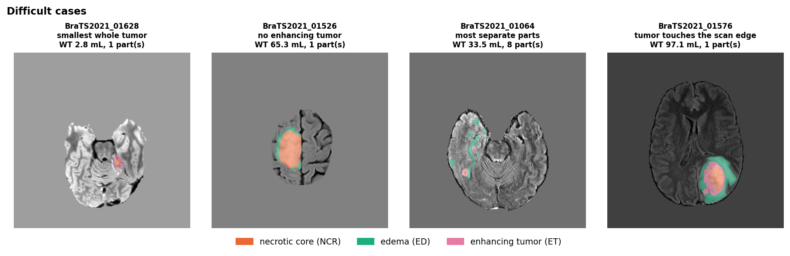

`results/eda/difficult_cases.csv` lists them per scan; the counts below are over all three cohorts:
- the 10 smallest whole tumors;
- 89 scans with no enhancing tumor;
- 121 scans with 3 or more separate tumor parts;
- 9 scans where the tumor touches the edge of the scan (3 in BraTS 2021, 6 in MU).

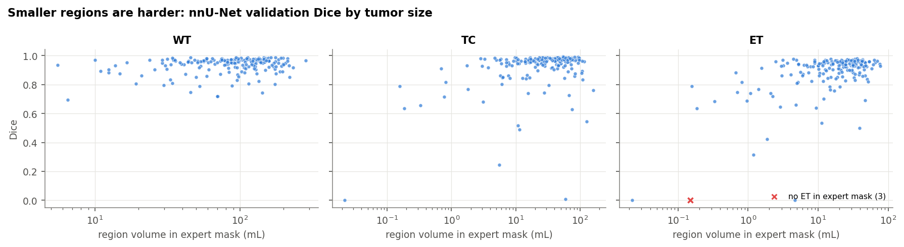

**Smaller regions get lower scores**, compared on the 188 BraTS 2021 validation patients with the selected model
(nnU-Net, M2-T04):

| Region | Spearman ρ (size vs Dice) | Median Dice, smallest quarter | Median Dice, other three quarters |
| --- | --- | --- | --- |
| WT | 0.15 | 0.944 | 0.958 |
| TC | 0.25 | 0.933 | 0.969 |
| ET | 0.34 | 0.872 | 0.940 |

The effect is strongest for ET, the smallest region. The error analysis in M3/M5 should therefore report scores by
tumor size, not only the average.

## 10. What this means for the models

| Finding | What we do about it |
| --- | --- |
| Raw intensities differ up to about 10× between scans (§3) | Z-score each MRI type inside the brain (M1-T04), so every scan has the same scale |
| Tumor voxels are a few percent of the brain, ET and NCR about 1% each (§5) | Dice + cross-entropy loss, and two thirds of the training patches centred on tumor (`configs/data/loader_v1.yaml`) |
| Each MRI type shows a different tumor part (§2) | Use all four types as model input; never drop one |
| Tumor sizes span two orders of magnitude, and many tumors have several parts (§4, §7) | Predict the whole volume with sliding windows (no cropping to one blob); report scores by size |
| Some scans have no ET (§7) | Expect ET Dice of 0 or 1 on them; report these cases separately (as the model card does) |
| Training and validation look alike (§8) | Validation scores are a fair check during development; the locked test set stays for the final evaluation |
| MU and RHUH are post-surgery and longitudinal, with a resection cavity in MU (§1, §4) | Used for the change-over-time module (M3), not for training the segmentation model |

## 11. Limits of this analysis

- **Sampled numbers:** the intensity statistics use 150 random scans each of BraTS 2021 and MU, and all 102 RHUH scans; the raw-vs-cleaned comparison uses
  10 BraTS 2021 patients.
- **Sizes are voxel counts of the expert masks.** They describe the datasets, not any patient population.
- **Locked data was not described:** the test patients and the external cohorts are described by counts only, so they
  stay usable for an honest final evaluation.

## How to reproduce

**Run:** open `notebooks/06_eda.ipynb` in Colab (CPU runtime) and **Run all**. Results are written to
`BrainMRI_Data/eda/` on Drive.

**Test:** `pytest tests/eda`.
