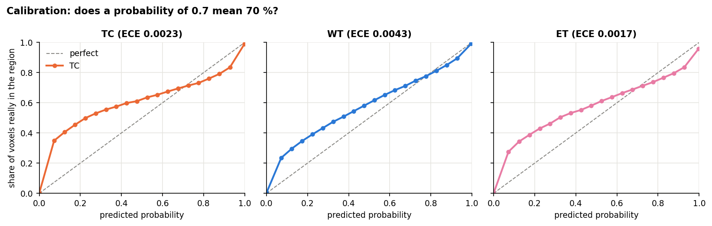
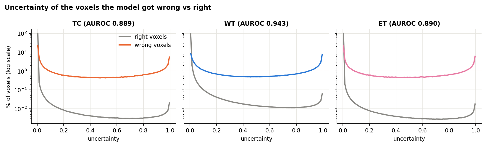
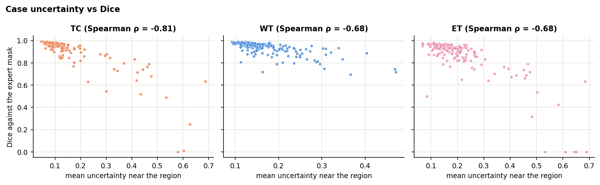
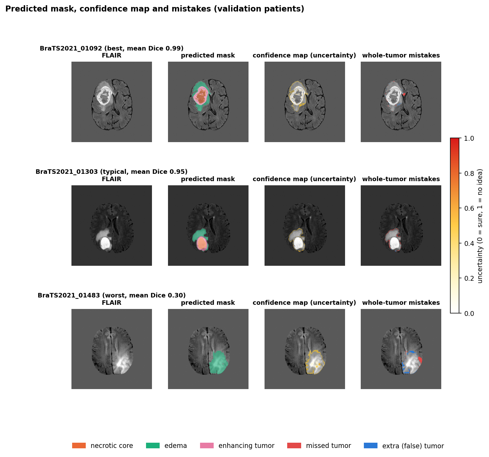

# Confidence (uncertainty) maps (M3-T04)

Every prediction of the selected model (seg-model v1, nnU-Net) comes with a map of where the model is unsure, so a
reader can see which parts of the mask to trust less.

> Research prototype. The map shows where *this model* is unsure; it is not a measure of clinical certainty and the
> system is not a medical device.

## How the map is made

The task asks to "run the model several times with small random changes and see where the answers differ".

**Why not dropout:**
- The board's example was switching dropout on at prediction time (Monte Carlo dropout).
- seg-model v1 has no dropout layers (nnU-Net's default), so switching dropout on is not possible.
- Training a dropout or ensemble version would change the selected model.

**Test-time augmentation instead:**
- The scan is predicted **8 times, once per mirror flip** (no flip, and every combination of the 3 axes).
- Each prediction is flipped back, and the 8 passes are compared voxel by voxel.
- nnU-Net does these same 8 flips anyway (its mirroring test-time augmentation), but it averages them in one go. Here
  they run one at a time so they can be compared.

**The mask does not change:** it is the argmax of the averaged logits, which is exactly what `nnUNetv2_predict`
returns for seg-model v1.

From the class probabilities of the 8 passes (background, NCR, ED, ET), per voxel:

| Map | Meaning | Range |
| --- | --- | --- |
| **uncertainty** (the confidence map) | normalized entropy of the averaged prediction: how unsure the final answer is | 0 = sure, 1 = all four classes equally likely |
| **disagreement** | the part of the uncertainty that comes from the 8 passes contradicting each other (mutual information) | 0..1 |
| flip rate per region (WT, TC, ET) | share of passes whose region mask differs from the final mask | 0..1 |

Code: `src/bmts/uncertainty/maps.py` (math, numpy only) and `src/bmts/uncertainty/nnunet_tta.py` (runs nnU-Net).

## Using it

```python
from bmts.uncertainty.nnunet_tta import load_predictor, predict_with_confidence
predictor = load_predictor(MODEL_DIR)                      # nnU-Net trainer folder of seg-model v1
seg, maps, props = predict_with_confidence(predictor, [t1, t1ce, t2, flair], out_dir="out", case_id="patient1")
# out/patient1_seg.nii.gz, out/patient1_uncertainty.nii.gz, out/patient1_disagreement.nii.gz
```

**Input:** cleaned scans (M1-T04), in the channel order T1, T1ce, T2, FLAIR.

**Cost:** a prediction takes about as long as `nnUNetv2_predict` with mirroring, because it is the same 8 passes.

**Per-case numbers:** `case_summary()` gives volumes, uncertain volume per region and mean uncertainty near the
tumor. The M3-T05 pipeline can report these next to the volumes.

## Does the map point at the mistakes? (188 validation patients)

**Run:** `notebooks/07_m3_t04_uncertainty.ipynb` → `scripts/uncertainty.py`. Results go to
`BrainMRI_Data/runs/M3-T04_uncertainty/`; a copy of the summary and figures is in `results/M3-T04/`.

**What it checks:**
- **Dice:** the same as seg-model v1 (a check that the 8 passes are combined correctly).
- **Calibration (ECE):** when the model says 70 %, is the voxel in the region about 70 % of the time?
- **Error detection (AUROC):** are the wrong voxels more uncertain than the right ones?
- **Case level:** do patients with a less certain map get lower Dice?

### Results (run of 15 Oct 2026, all 188 validation patients, 8 passes each)

| Region | Dice | ECE | Error AUROC | Wrong voxels flagged as uncertain | Brain voxels flagged | Spearman ρ (case uncertainty vs Dice) | Worst-Dice quarter found in the most uncertain quarter |
| --- | --- | --- | --- | --- | --- | --- | --- |
| TC | 0.917 | 0.0023 | 0.889 | 39.2 % | 0.33 % | −0.81 | 72 % |
| WT | 0.935 | 0.0043 | 0.943 | 47.4 % | 1.07 % | −0.68 | 68 % |
| ET | 0.872 | 0.0017 | 0.890 | 41.1 % | 0.28 % | −0.68 | 70 % |

"Flagged" means region uncertainty above 0.5; percentages of voxels are over the voxels inside the brain.

**The mask is unchanged.** Dice is exactly seg-model v1's (TC 0.917, WT 0.935, ET 0.872). Running the 8 passes
separately and averaging them gives the same mask as `nnUNetv2_predict`.

**The overall calibration error is small, but the in-between probabilities are too low:**
- **Why ECE is small.** The expected calibration error is below 0.5 % in every region, mostly because almost every
  brain voxel gets a probability near 0 or near 1, and those are right.
- **The in-between range (the reliability diagram below).** The voxels with in-between probabilities are the tumor
  border, where the confidence map lights up:
  - **Below about 0.7 the probabilities are too low.** Of the voxels given about 10 %, roughly a quarter (WT, ET) to a
    third (TC) really are in the region. Of those given about 50 %, roughly 60 % are.
  - **Above 0.7 they are close to right,** slightly too high near 0.9 for TC and ET.
- **What this means:** at the tumor border, the true region tends to reach a little further than the model's
  probabilities suggest. Read the probabilities there as a ranking (more or less likely), not as exact percentages.



**The map points at the mistakes, but it does not catch all of them:**
- **Wrong voxels are more uncertain.** Picking one wrong and one right voxel at random, the wrong one has the higher
  uncertainty 89–94 % of the time (AUROC 0.889–0.943).
- **A small flag catches a large share of the errors.** Marking only the 0.3–1.1 % of brain voxels with uncertainty
  above 0.5 catches 39–47 % of all wrong voxels.
- **Most mistakes are still made with confidence.** More than half of the wrong voxels are *not* flagged, so a low
  uncertainty does not mean the mask is right there. The map tells a reader where to look first; it does not replace
  checking the mask.



**Uncertain patients are the ones with lower Dice:**
- **Strong correlation.** The mean uncertainty near each region falls as that patient's Dice rises (Spearman ρ −0.68
  to −0.81).
- **The worst cases stand out.** Of the quarter of patients with the lowest Dice, about 70 % (68–72 %) are also among
  the quarter with the highest uncertainty. Picking at random would give 25 %.
- **This can drive a per-scan flag.** A case-level uncertainty score is a reasonable way to mark scans whose mask
  needs a closer look. This is a validation-set result, not a tested clinical rule.





**Speed:** 20.6 seconds per patient on a Colab T4, the same as a normal `nnUNetv2_predict` run with mirroring.

## Limits

- **Only some of the uncertainty is captured.** Mirror flips mostly reveal uncertainty at tumor borders and in
  ambiguous tissue. They do not capture how unsure the model's own weights are: there is only one trained model and
  it has no dropout.
- **No guarantee on new kinds of scans.** A low-uncertainty map on a post-treatment scan or another scanner does not
  mean the mask is right there, because the model never saw such scans.
- **Checked on validation patients only;** the locked test set is kept for the final evaluation.
